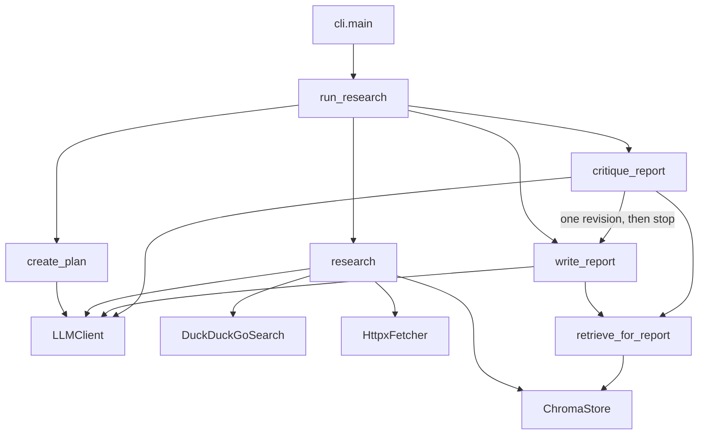

# Multi-Agent Research Assistant

A command-line research assistant that plans sub-questions, reads public web pages, and writes a short cited report with a bounded critic loop.

Plain Python functions. One Gemini model. No agent framework.

## Overview

Given a topic, the program asks a model for a few sub-questions, searches DuckDuckGo, fetches pages, and keeps a finding only when the quoted sentence is on the fetched page. Chunks of those pages are stored in Chroma with the source URL. A writer drafts a report from the findings and a handful of retrieved chunks. A critic can send the draft back to the writer once. The loop stops after two critic passes even if the second critique still fails.

The point is to keep citations tied to pages the program actually downloaded, and to keep a free-tier run from continuing without a cap.

Live Gemini, DuckDuckGo, and page-fetch behaviour has not been executed in this environment. The evaluation harness has not been run, so this README does not quote accuracy, latency, or cost.

## Key features

- Fixed pipeline: plan, search, fetch, extract, write, critique, and at most one revision.
- Pydantic models for the plan, findings, report, and critique. One repair call if JSON validation fails.
- Quote check: a finding is dropped when its URL was not fetched or its quote is not a substring of the page.
- Chroma storage with caller-supplied embeddings. Gemini embeddings when `GEMINI_API_KEY` is set, otherwise a local hashing embedder.
- Disk cache for successful LLM, search, and completed fetch responses. Cache hits do not spend the call budget.
- Exponential backoff on transient Gemini errors. Integer caps on LLM calls, searches, fetches, embed batches, and loop steps.
- Optional outline approval (`--approve-outline`) and optional markdown file (`--out`).
- Ten-topic eval harness with a deterministic URL and quote check. Results are not recorded yet.

## Architecture



Fetched page text is wrapped in `<untrusted_web_content>` and the prompts tell the model that this text is data. That fence is not a guarantee. See [Security](#security-considerations).

## Tech stack

| Piece | Role in this repo |
| --- | --- |
| Python 3.11+ (local venv is 3.13) | Runtime |
| Pydantic 2 | `Settings` and every structured payload |
| `google-genai` | Gemini generate and embed calls, only from `GeminiBackend` and `GeminiEmbedder` |
| `ddgs` | DuckDuckGo text search inside `DuckDuckGoSearch._raw` |
| `httpx` | Page download |
| BeautifulSoup (`html.parser`) | Title and visible text, with script, style, and noscript removed |
| Chroma | Persistent chunk store when the CLI runs. Tests use the ephemeral client |
| `python-dotenv` | Loads `.env` if the file exists |
| pytest | Unit tests with fakes. No live network |

There is no CI workflow in the tree, so there is no build badge.

## How it works

1. `cli.main` parses the topic and calls `load_settings` then `build_runtime`.
2. `create_plan` asks the model for a `ResearchPlan` and replaces the topic with the user's string. Sub-questions are sliced to `max_subquestions` (default 3).
3. Unless `--approve-outline` is set, the outline is accepted. For each question, `research` searches (default 2 hits), fetches, chunks (800 characters, overlap 120), and stores vectors.
4. `complete_model` returns a `FindingBatch`. `_supported` keeps items whose quote is on the fetched page.
5. `write_report` retrieves up to `top_k` chunks (default 4) with one query and asks for a `Report`.
6. `critique_report` returns a `Critique`. A rejection triggers `revise_report` and one more critique. The second rejection does not trigger another rewrite.
7. `report_to_markdown` prints the report. `--out` writes the same markdown.

`BudgetExceededError` and `StepLimitError` stop the loop with `stopped_reason` of `budget` or `step_limit`. A JSON failure after the repair attempt raises `OutputValidationError` and is not turned into that clean stop.

## Project structure

```text
ai-agent-project/
  src/
    __main__.py          # python -m src
    cli.py               # argparse, markdown, exit codes
    config.py            # Settings and environment variables
    runtime.py           # wires Gemini, search, fetch, Chroma
    budget.py            # per-run call caps
    cache.py             # disk cache
    errors.py
    textutil.py          # quote substring check
    agent/
      loop.py            # run_research
      steps.py           # StepGuard
      planner.py
      researcher.py
      writer.py
      critic.py
    llm/
      client.py          # LLMClient, GeminiBackend, backoff
      jsonio.py
      prompts.py
      schemas.py
    tools/
      search.py
      fetch.py
    rag/
      chunking.py
      embeddings.py
      store.py
      retrieve.py
  tests/                 # mocked pytest suite
  evals/
    topics.jsonl         # 10 topics
    checks.py
    run_evals.py         # live runner, not executed here
  docs/
    SYSTEM_DESIGN.md
    BASICS_AND_DATA_FLOW.md
    INTERVIEW_QUESTIONS.md
  DECISIONS.md
  requirements.txt
  pytest.ini
  .env.example
  .gitignore
```

## Prerequisites

- Python 3.11 or newer. On this machine the virtualenv was created with CPython 3.13.
- Network access only when you intentionally run the CLI or the eval runner against Gemini and the web.
- A Gemini API key for a real report. Unit tests do not need one.

## Setup

### Windows PowerShell

From the project root:

```powershell
py -3 -m venv .venv
.\.venv\Scripts\Activate.ps1
pip install -r requirements.txt
Copy-Item .env.example .env
```

Edit `.env` and set `GEMINI_API_KEY`. Do not commit `.env`.

### macOS / Linux

```bash
python3 -m venv .venv
source .venv/bin/activate
pip install -r requirements.txt
cp .env.example .env
```

Set `GEMINI_API_KEY` in `.env` the same way.

Without a key, imports and `python -m pytest` still run. `build_embedder` uses the hashing embedder. The first live `GeminiBackend.generate` raises `RuntimeError` because the key is missing.

## Configuration

`load_settings` reads `.env` when that file exists (`override=False`: a variable already set in the process wins). `Settings.trimmed()` then clamps a few values. Defaults below are the values in `src/config.py` before clamping. Clamps are noted in the last column.

| Variable | Default | Meaning | Clamp |
| --- | --- | --- | --- |
| `GEMINI_API_KEY` | empty | Gemini key. Empty selects the hashing embedder and makes live generation fail | |
| `GEMINI_MODEL` | `gemini-2.5-flash` | Model passed to `generate_content` | |
| `GEMINI_EMBED_MODEL` | `gemini-embedding-001` | Model passed to `embed_content` | |
| `GEMINI_TEMPERATURE` | `0.2` | `GenerateContentConfig.temperature` | |
| `MAX_LLM_CALLS` | `12` | Charged per generate attempt, including retries and the repair call. Cache hits are free | minimum 0 |
| `MAX_SEARCHES` | `6` | Charged per DuckDuckGo call that misses the cache | minimum 0 |
| `MAX_FETCHES` | `6` | Charged per HTTP GET that misses the cache | minimum 0 |
| `MAX_EMBED_CALLS` | `40` | Charged per Gemini embed batch. The hashing embedder does not charge | minimum 0 |
| `MAX_STEPS` | `40` | `StepGuard` ticks | minimum 1 |
| `MAX_RETRIES` | `3` | Attempts per LLM or embed request | minimum 1 |
| `RETRY_BASE_SECONDS` | `0.5` | First backoff delay. Later delays double | |
| `VALIDATION_REPAIRS` | `1` | Extra model calls after invalid JSON | minimum 0 |
| `CRITIC_MAX_ITERATIONS` | `2` | Critic passes | forced into 1..2 |
| `CHUNK_SIZE` | `800` | Character window | minimum 1 |
| `CHUNK_OVERLAP` | `120` | Overlap. If it is greater than or equal to the size, `chunk_text` uses `size // 4` | minimum 0 |
| `TOP_K` | `4` | Chunks retrieved for the writer and critic | minimum 1 |
| `FETCH_MAX_CHARS` | `6000` | Extracted text kept from a page, then `\n[truncated]` | |
| `FETCH_TIMEOUT_SECONDS` | `15` | httpx timeout | |
| `SEARCH_RESULTS_PER_QUERY` | `2` | Hits requested per sub-question | minimum 1 |
| `MAX_SUBQUESTIONS` | `3` | Questions researched after the plan returns | forced into 1..4 |
| `CACHE_DIR` | `data/cache` | Disk cache root | |
| `CHROMA_DIR` | `data/chroma` | Chroma persistent directory | |

`.env.example` lists the same keys. A cap of 0 means the next charge fails immediately.

## Usage

The argparse program name is `research-agent`. Both of these call `src.cli.main`:

```powershell
python -m src.cli "how solid-state batteries differ from lithium-ion batteries"
python -m src "how solid-state batteries differ from lithium-ion batteries"
```

Flags, copied from `build_parser`:

| Flag | Behaviour |
| --- | --- |
| `topic` | Required positional research topic |
| `--approve-outline` | Print the outline and wait for approval before searching. Empty input, `y`, and `yes` approve. Anything else stops the run |
| `--out PATH` | Write the report markdown to this path after printing it. Parent directories are created |

```powershell
python -m src.cli "how solid-state batteries differ from lithium-ion batteries" --approve-outline
python -m src.cli "how public-key cryptography lets two people share a secret" --out data\report.md
```

```bash
python -m src.cli "how solid-state batteries differ from lithium-ion batteries" --approve-outline
python -m src.cli "how public-key cryptography lets two people share a secret" --out data/report.md
```

Exit code `0` means `result.report` is present, including when the last critique is still unapproved. In that case the CLI also prints `Critic still has open issues after the revision cap:` and each issue. Exit code `1` means the report is missing (`outline_rejected`, `budget`, or `step_limit`). The message is `Stopped: <reason>`.

### Illustrative output

This markdown is the shape `report_to_markdown` produces from the `Report` schema. It is not a captured run.

```markdown
# Solid-state batteries

They replace liquid electrolytes.

## Mechanism

Solid-state batteries replace liquid electrolytes with solid ones.

Citations: https://example.com/ssb

## Sources

- https://example.com/ssb
```

The matching object is `Report` with `title`, `summary`, `sections` (`heading`, `body`, `citations`), and `sources`, as defined in `src/llm/schemas.py`.

## Testing

```powershell
python -m pytest
```

Tests live in `tests/` and use `ScriptedBackend`, `FakeSearch`, and `FakeFetch`. They do not call Gemini, DuckDuckGo, or the network. They show that the loop, the quote filter, the cache, the caps, and the CLI flags behave as coded. They do not show that a live model writes true reports.

## Evaluation

The harness is implemented. Results do not exist.

`evals/topics.jsonl` has ten topics. `evals/checks.py` records whether a finding URL returns a status in `[200, 400)` and whether the quote is contained in that body. No LLM judge is implemented. No score has been computed.

To run it after `GEMINI_API_KEY` is set (this performs live Gemini, DuckDuckGo, and page fetches, and it uses one shared budget for all ten topics):

```powershell
python -m evals.run_evals
```

That writes `data/eval_results.json`. The file is not in the repository. Do not treat a green pytest run as an eval result.

## Design decisions

Summary of `DECISIONS.md`:

- Hand-written functions and a step-limited loop, not a framework and not a ReAct tool picker.
- `gemini-2.5-flash` by default, name in config.
- Official `google-genai` SDK behind `GeminiBackend` and `GeminiEmbedder`.
- DuckDuckGo behind `SearchProvider`, because it needs no search key.
- Chroma with embeddings computed by our code.
- Hashing embedder when no API key is set.
- JSON schema in the prompt, Pydantic validation, one repair.
- Disk cache and exponential backoff. Failures without an HTTP status are not cached.
- Integer call caps instead of a dollar cap.
- 800-character chunks with overlap 120. Not a measured bakeoff.
- Outline approval only with `--approve-outline`.
- Critic cap of two passes.

## Security considerations

- Page text is untrusted. Prompts say so, and `fence_untrusted` wraps it. A page can still influence the model.
- Findings with off-page quotes or unknown URLs are dropped in `researcher._supported`. Report citation strings are not checked the same way before printing.
- The API key stays in the environment. `data/` (cache and Chroma) is gitignored and can contain page text.
- Fetch limitations that are not handled: no host allowlist, redirects are followed, and the full response body is read before truncation. A search hit can therefore cause a request to an internal address or a very large download.

## Status

Unit tests are part of the repo and mock the model and the network. Live end-to-end behaviour has not been verified here. Evaluation results have not been recorded.

## Known limitations

- The critic can leave a report unapproved. The CLI still prints it and exits 0.
- `OutputValidationError` and a final transient LLM error are not converted into `Stopped:`.
- The hashing embedder is not semantic. Gemini embedding quality has not been measured.
- Old Chroma collections under `data/chroma` are not deleted.
- The eval runner shares one budget and one collection across all ten topics.
- There is no token counter and no dollar cap.
- There is no branch that skips the web and reuses an older collection.
- Fetch has the SSRF and oversized-body gaps described above.

## Roadmap

Not implemented, in the order I would extend the current code:

- Map validation failures to a `stopped_reason` instead of a traceback.
- Check report citation URLs in Python, the same way findings are checked.
- Cap download size and reject non-public hosts before `httpx` follows a redirect.
- Give each eval topic its own budget and collection, then run `evals/run_evals.py` and commit the JSON it actually writes.
- Only after that: a worker and a small HTTP API in front of `run_research`, plus one JSON line per external call.

## Further reading

- [docs/SYSTEM_DESIGN.md](docs/SYSTEM_DESIGN.md) — requirements, components, failure modes, security, testing, scaling notes
- [docs/BASICS_AND_DATA_FLOW.md](docs/BASICS_AND_DATA_FLOW.md) — concepts, one full run, error paths, glossary
- [docs/INTERVIEW_QUESTIONS.md](docs/INTERVIEW_QUESTIONS.md) — questions and answers tied to this code
- [DECISIONS.md](DECISIONS.md) — choices and trade-offs
