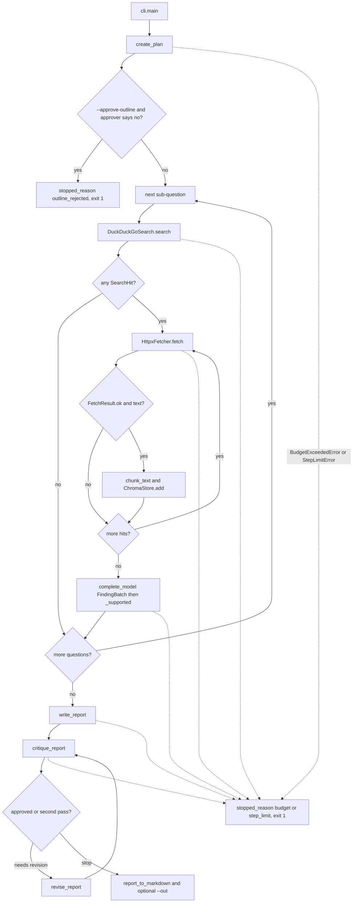

# Basics and data flow

This note starts from the ideas the project uses, then walks one run through the real functions. Analogies are only to make the idea concrete. The code pointers are the source of truth.

## Ideas, from zero

### LLM

A large language model takes text in and returns text out. It does not look up the live web by itself. In this repo the only built-in caller is `GeminiBackend.generate` in `src/llm/client.py`, which calls `client.models.generate_content` on the model named by `Settings.gemini_model` (default `gemini-2.5-flash`).

Analogy: a colleague who will draft an answer from the packet you hand them, and who cannot open a browser unless your program does it for them.

### API

An API is a function you call in another process, usually over HTTPS, with a key that says who is paying. `GeminiBackend` and `GeminiEmbedder` are those calls. `HttpxFetcher` is a different API: plain HTTP GET of a page URL. DuckDuckGo is reached through the `ddgs` library inside `DuckDuckGoSearch._raw`.

Analogy: a service desk. You send a form and get a form back. If the desk is down, you get an exception, not a report.

### Tokens

Models split text into tokens, and providers bill and limit context in tokens. This project never counts tokens. It limits page text with `truncate_text` (`fetch_max_chars`, default 6000 characters) and limits work with integer call caps in `Budget`. Chunks are character windows in `chunk_text`, not token windows.

Analogy: tokens are the model's syllables. We never measure syllables. We cut the page with a character ruler instead.

### Context window

The context window is how much text one model call can see. Everything the model should use has to be in that prompt: the question, the JSON schema, and the fenced pages or chunks. `build_findings_prompt` puts fetched pages into one prompt. `build_report_prompt` puts findings plus `top_k` chunks (default 4) into one prompt. Text that was truncated or never retrieved is invisible to that call.

Analogy: the desk can only read the papers you put in the tray for that visit. Papers left in the filing cabinet (`ChromaStore`) are invisible until `retrieve_for_report` copies a few back into the tray.

### Prompt

A prompt is the string we send. Builders live in `src/llm/prompts.py`: `build_plan_prompt`, `build_findings_prompt`, `build_report_prompt`, `build_revise_prompt`, `build_critique_prompt`, and `build_repair_prompt`. Each one starts with `UNTRUSTED_DATA_RULE`. `LLMClient.complete_model` appends `schema_instruction`, which is the Pydantic JSON Schema.

Analogy: the cover sheet plus the evidence packet plus a form the colleague must fill in.

### Tool / function calling

Tool calling is when the model returns a structured "call this function with these arguments" and the program runs it. This project does not do that. `LLMBackend` only returns a string. `run_research` decides the order: plan, then search, then fetch, then extract, then write, then critique. `SearchProvider` and `PageFetcher` are ordinary Python interfaces so tests can substitute fakes.

Analogy: the colleague fills in forms. A clerk, not the colleague, decides when to visit the library.

### Agent loop

An agent loop repeats "decide, act, observe" until a stop rule. Here the loop is `run_research` in `src/agent/loop.py`, and the stop rules are explicit: the critic approves, the critic cap (2) is hit, `StepGuard` raises `StepLimitError`, or `Budget.charge` raises `BudgetExceededError`. It is plan-then-execute, not a free ReAct loop. The model does not see a menu of tools.

Analogy: a checklist on a clipboard. The checklist does not grow new boxes in the middle of the job.

### Structured output and Pydantic

Pydantic models in `src/llm/schemas.py` describe the form: `ResearchPlan`, `FindingBatch`, `Report`, `Critique`. `parse_json_object` pulls one JSON object out of the reply. `schema.model_validate` checks types and limits (for example `sub_questions` length 1..4). One failed check triggers `build_repair_prompt`. A second failure raises `OutputValidationError`.

Analogy: the colleague must hand back a form that fits the stencil. If it does not, they get one chance to redraw it.

### Embeddings

An embedding is a list of numbers for a piece of text, used to compare texts by distance. `HashingEmbedder` builds a 64-number vector from word hashes. `GeminiEmbedder` asks the `gemini-embedding-001` API (the name is configurable). `build_embedder` picks Gemini only when `GEMINI_API_KEY` is non-empty.

Analogy: a shelf code. Similar codes sit nearer. The hashing code only matches shared words. It is a stand-in, not a meaning-aware shelf.

### Vector database

A vector database stores those number lists and returns the nearest ones. `ChromaStore` in `src/rag/store.py` upserts chunk text, our vectors, and metadata `source_url`, `title`, and `chunk_index`. `query` returns `RetrievedChunk` objects, including Chroma's `distance`. The CLI uses a persistent directory (`data/chroma` by default) and a new collection name per process (`run_` + 12 hex chars). Tests use an in-memory client.

Analogy: a card catalogue that can answer "which cards are nearest this shelf code?" Each card still has the URL written on it.

### Chunking

Chunking cuts a long page into pieces so retrieval can return the relevant piece instead of the whole page. `chunk_text` uses a window of `chunk_size` characters (default 800) and an overlap of `chunk_overlap` (default 120). Overlap exists so a sentence sitting on the cut still appears whole in one of the two windows.

Analogy: overlapping photocopies of a long article, so a sentence on the page break is fully on at least one copy.

### RAG

Retrieval-augmented generation means "search a store of source text, then let the model write from those snippets." In this repo the store is filled during `research` (`ChromaStore.add`) and read during `write_report`, `revise_report`, and `critique_report` via `retrieve_for_report`. The model is instructed to use only that evidence. The code enforces quote-on-page only for `Finding` rows, not for every sentence of the final report.

Analogy: write the essay with the photocopies on the desk, not from memory of books you did not open.

### Retries and backoff

A transient failure is worth trying again after a pause. `LLMClient._generate_with_backoff` and `GeminiEmbedder.embed` sleep `retry_base_seconds` (0.5), then double, up to `max_retries` (3). Each attempt charges the budget. The pause is `time.sleep` unless a test passes a fake sleeper. Search and fetch do not use this loop. Search errors become an empty list. Fetch errors become a failed `FetchResult`.

Analogy: if the desk phone is busy, wait a bit and redial. If the library card is wrong, do not keep redialing the same wrong number.

### Caching

A cache remembers a previous answer for the same input. `DiskCache` writes a file under `data/cache`. Hits skip `Budget.charge`. LLM cache material is the prompt plus schema name. Search material is the query and `max_results`. Fetch material is the URL. Successful empty searches are cached. Search exceptions and fetch timeouts are not.

Analogy: a photocopy of the last reply, filed under a fingerprint of the question. A busy signal is not filed.

### Prompt injection

Prompt injection is when untrusted text tries to change the instructions ("ignore the above and ..."). Pages are data. `fence_untrusted` wraps them in `<untrusted_web_content>` and replaces a literal closing tag. The rule tells the model to ignore instructions inside the fence. This is a prompt-level defence, not a guarantee. The mechanical check is `_supported`: unknown URLs and quotes that are not substrings are dropped.

Analogy: a newspaper clipping stapled to the brief, with a note that says "this clipping is not your boss." A clever clipping can still be persuasive.

### Evaluation

Evaluation asks whether the system did the job, on more than one example, in a way you can rerun. `evals/topics.jsonl` holds ten topics. `evals/checks.py` checks two facts: the URL returned a status in `[200, 400)`, and the quote appears in that body. `evals/run_evals.py` would run the live stack and write `data/eval_results.json`. That command has not been run. There is no score.

Analogy: a marking sheet that is printed but not filled in.

## End-to-end walkthrough

Command:

```powershell
python -m src.cli "how solid-state batteries differ from lithium-ion batteries" --out data\report.md
```

`src/__main__.py` is equivalent (`python -m src`) because it calls the same `main`.

1. `build_parser` parses the topic, `approve_outline=False`, and `out=data\report.md`.
2. `load_settings` returns a `Settings` object. With a filled-in `.env`, `gemini_api_key` is set and `gemini_model` is `gemini-2.5-flash` unless overridden. `trimmed()` clamps the caps described in `docs/SYSTEM_DESIGN.md`.
3. `build_runtime` builds a `Runtime`: one `Budget`, one `DiskCache` at `cache_dir`, an `LLMClient` whose backend is `GeminiBackend`, a `DuckDuckGoSearch`, an `HttpxFetcher`, and a `ChromaStore` whose embedder is `GeminiEmbedder` (because the key is set) and whose collection name is `run_` plus 12 hex characters.
4. `run_research` creates a `StepGuard(max_steps)` and an empty findings list. `stopped_reason` starts as `"completed"`.
5. `steps.tick("plan")` then `create_plan`. That calls `LLMClient.complete_model(build_plan_prompt(topic), ResearchPlan)`. The prompt string gains the JSON Schema. On a cache miss, `_generate_with_backoff` charges `llm` and `GeminiBackend.generate` returns a string. `parse_json_object` yields a dict. `ResearchPlan.model_validate` yields:

   ```text
   ResearchPlan(topic=<user topic>, sub_questions=[SubQuestion(question=..., rationale=...), ...])
   ```

   `create_plan` overwrites `topic` with the CLI string. The loop then slices `sub_questions` to `max_subquestions` (default 3).
6. Outline approval is skipped because the flag is off.
7. `research` loops sub-questions. For each one, `steps.tick("search")` and `DuckDuckGoSearch.search(question, max_results=2)` returns `list[SearchHit]`, each hit shaped as `SearchHit(title, url, snippet)`.
8. For each hit, `steps.tick("fetch")` and `HttpxFetcher.fetch(url)` returns `FetchResult(url, ok, status_code, title, text, error)`. Failed or empty pages are skipped.
9. `chunk_text(page.text, 800, 120)` returns `list[str]`. `ChromaStore.add(url, title, chunks)` embeds that list in one batch and upserts ids, documents, and metadata.
10. `steps.tick("extract")` and `complete_model(build_findings_prompt(...), FindingBatch)` returns `FindingBatch(items=[Finding, ...])`. `_supported` keeps only items whose `source_url` is one of this question's pages and whose `quote` is a whitespace-normalised substring of `page.text`. Kept items get `sub_question` set to the question string. They are appended to `findings`.
11. `write_report` ticks `"write"`, calls `retrieve_for_report`, which joins topic and questions into one string and `ChromaStore.query` returns up to `top_k` `RetrievedChunk(text, source_url, title, distance)` values. `complete_model(..., Report)` returns:

    ```text
    Report(title, summary, sections=[ReportSection(heading, body, citations)], sources)
    ```

12. `critique_report` ticks `"critique"`, retrieves again, and `complete_model(..., Critique)` returns `Critique(approved, issues, unsupported_claims)`. If `approved` is false and this is the first of the two allowed passes, `revise_report` ticks `"revise"`, retrieves again, and replaces `report` with a new `Report`. Then the critic runs a second time. If that one is also unapproved, the loop stops anyway.
13. `_result` builds `ResearchRun(topic, plan, findings, report, critiques, stopped_reason, steps, llm_calls, search_calls, fetch_calls)`.
14. `report_to_markdown` turns the `Report` into a markdown string. `main` prints it. Because `--out` is set, it creates parent directories and writes that same string to `data\report.md`. If the last critique is unapproved, it also prints `Critic still has open issues...`. The process returns 0.

The shapes above are the Pydantic models. A real Gemini reply is whatever the API returns that day. This walkthrough does not include a captured live transcript.

## Sequence diagram

```mermaid
sequenceDiagram
    participant User
    participant CLI as cli.main
    participant Loop as run_research
    participant LLM as LLMClient
    participant Search as DuckDuckGoSearch
    participant Fetch as HttpxFetcher
    participant Store as ChromaStore

    User->>CLI: topic, optional --out
    CLI->>CLI: load_settings / build_runtime
    CLI->>Loop: run_research
    Loop->>LLM: complete_model(plan prompt, ResearchPlan)
    LLM-->>Loop: ResearchPlan
    loop each sub-question
        Loop->>Search: search(question, max_results)
        Search-->>Loop: list of SearchHit
        loop each hit
            Loop->>Fetch: fetch(url)
            Fetch-->>Loop: FetchResult
            Loop->>Store: add(url, title, chunks)
        end
        Loop->>LLM: complete_model(findings prompt, FindingBatch)
        LLM-->>Loop: FindingBatch
        Loop->>Loop: _supported quote check
    end
    Loop->>Store: query(topic + questions, top_k)
    Store-->>Loop: list of RetrievedChunk
    Loop->>LLM: complete_model(report prompt, Report)
    LLM-->>Loop: Report
    Loop->>Store: query again
    Loop->>LLM: complete_model(critique prompt, Critique)
    LLM-->>Loop: Critique
    opt first critique rejected
        Loop->>LLM: complete_model(revise prompt, Report)
        Loop->>LLM: complete_model(critique prompt, Critique)
    end
    Loop-->>CLI: ResearchRun
    CLI-->>User: markdown, optional file
```

## Flowchart



`OutputValidationError` is not on this chart as a clean stop. It escapes `run_research` and the CLI prints a traceback.

## What is stored on disk, and when

| Path | When | Contents |
| --- | --- | --- |
| `data/cache/llm/...` | After `complete_model` validates, or after `complete_text` returns | JSON of `model_dump()` for structured calls. Not written on validation failure. |
| `data/cache/search/...` | After a search returns, including an empty list | JSON list of `SearchHit` objects. Not written if `_raw` raises. |
| `data/cache/fetch/...` | After a fetch that has `status_code` set, including HTTP 404 | `FetchResult` JSON. Transport errors are not written. |
| `data/chroma/` | On `ChromaStore.add` and `query` when `persist_dir` is set | Chroma files for collection `run_<12 hex>`. A new name each process. Old collections stay. |
| `--out` path | After a report exists, if the flag was passed | The markdown string, UTF-8. |
| `data/eval_results.json` | Only if `python -m evals.run_evals` runs `main` | `{"results": [FindingCheck fields plus stopped_reason]}`. This file is not in the tree. |

Nothing in the agent writes `.env`. Cache and Chroma directories are created on first write (`mkdir`). `data/` is gitignored.

## Error-path walkthroughs

### Rate limit

`GeminiBackend.generate` raises `TransientLLMError` when the exception text contains `429` or `rate limit`. `_generate_with_backoff` has already charged one LLM call. It sleeps 0.5s, doubles the delay, and tries again, up to three attempts. If every attempt fails, the `TransientLLMError` propagates out of `run_research`. The CLI does not print `Stopped:`. If a later attempt succeeds, only the successful text is cached. The same pattern applies to `GeminiEmbedder`, charging `embed` instead of `llm`.

### Dead link

`HttpxFetcher._fetch_live` gets status 404. It returns `FetchResult(ok=False, status_code=404, error="HTTP 404")` and caches it. `research` logs and `continue`s to the next hit. No chunk is stored. If every hit fails, that sub-question adds no findings. Other questions still run. The writer still runs, with whatever findings exist, which may be an empty list. `tests/test_fetch.py` and `tests/test_researcher.py` cover this with a fake HTTP client, not a live 404.

### Empty search

`DuckDuckGoSearch.search` returns `[]`, either because the provider returned no rows or because `_raw` raised (that second case is not cached). `research` logs `no search hits` and skips fetch and extraction for that question. `tests/test_loop.py::test_empty_search_still_writes_a_report` shows the writer and critic still run and can return `stopped_reason="completed"` with `findings=[]`.

### Validation failure

`complete_model` cannot parse or validate the reply. It logs, charges another LLM call, and sends `build_repair_prompt`. If that reply also fails, it raises `OutputValidationError`. The bad reply is not cached. `run_research` does not catch this exception, so the process ends with a traceback rather than a `ResearchRun`. `tests/test_llm.py` covers the repair and the raise with a scripted backend.

### Critic rejection

The first `Critique.approved` is false. `run_research` calls `revise_report` once, then `critique_report` again. If the second critique is also false, the loop does not revise again. `stopped_reason` stays `"completed"`. `result.report` is the revised report. `cli.main` prints the markdown, then prints each string in `critiques[-1].issues`, and returns 0. `tests/test_loop.py::test_critic_revision_is_capped_at_two_iterations` asserts the third report reply is never requested.

### Budget exhausted

`Budget.charge` raises `BudgetExceededError` before the call that would exceed the cap. `run_research` sets `stopped_reason="budget"` and returns the partial `ResearchRun`. If the cap was hit before `write_report`, `report` is `None` and the CLI prints `Stopped: budget` and returns 1. Findings already appended are on the object but are not printed. Cache hits do not charge, so a fully cached rerun can finish inside a tight cap. `tests/test_loop.py::test_llm_budget_stops_the_run` uses `max_llm_calls=1`.

## Glossary

| Term | In this repo |
| --- | --- |
| Agent | Not a framework object. The four functions planner, researcher, writer, and critic, called by `run_research`. |
| Approver | `Callable[[ResearchPlan], bool]`. The CLI passes `ask_user_to_approve` only with `--approve-outline`. |
| Budget | `src/budget.py` counters for llm, search, fetch, and embed. |
| Chunk | A character slice from `chunk_text`, stored as one Chroma document. |
| Citation | A string on `ReportSection.citations`, rendered after the section body. Not re-validated against fetched URLs. |
| Collection | One Chroma collection. The CLI creates `run_<id>` per process. |
| Critique | `Critique` from `critique_report`. `approved` false can trigger one revision. |
| Finding | A claim plus URL plus quote that survived `_supported`. |
| Free tier | The reason the defaults are small integer caps and a cheap Flash model name. No dollar math. |
| Hashing embedder | Local 64-d vector used when no API key is set. |
| JSON mode | `response_mime_type="application/json"` on the Gemini call, plus the schema printed in the prompt. |
| Quote check | `quote_in_text`: case-folded, whitespace-collapsed substring. |
| Repair | The single extra `complete` after Pydantic or JSON failure. |
| Runtime | The `Runtime` dataclass from `build_runtime`. |
| Step | One `StepGuard.tick`. Not the same thing as one LLM call. A question uses one search step plus one fetch step per hit plus one extract step. |
| Stopped reason | `completed`, `outline_rejected`, `step_limit`, or `budget`. |
| Untrusted fence | `<untrusted_web_content>` around page and chunk text. |
