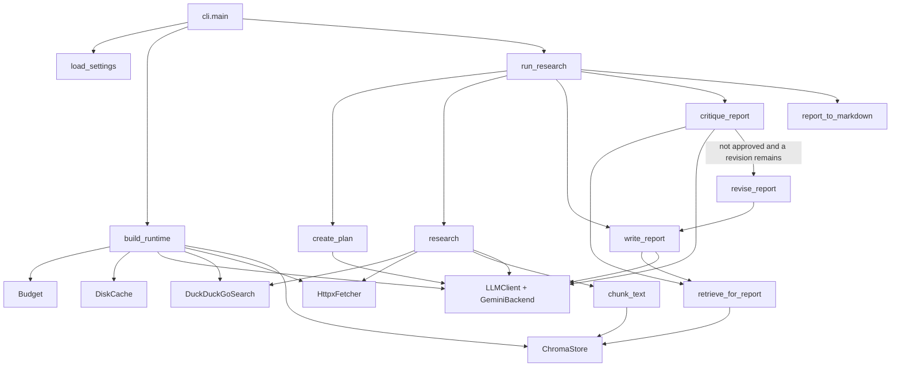

# System design

This document describes the research assistant as the code behaves today. Live Gemini, DuckDuckGo, and page-fetch calls were not run while writing it. No latency, accuracy, cost, or eval score is stated, because those numbers have not been measured.

## Requirements

### Functional

- Accept a topic on the command line and return a markdown report.
- Break the topic into a small list of sub-questions (`ResearchPlan`).
- Search the public web, fetch pages, and keep only findings whose quote is present in the fetched text.
- Store page chunks with the source URL and title, then retrieve a few chunks when writing and critiquing.
- Produce a `Report` with a title, summary, sections, per-section citations, and a source list.
- Run a critic that can reject the draft and send it back to the writer, with a hard cap of two critic passes.
- Optionally stop after the outline and ask a person to approve it (`--approve-outline`).
- Optionally write the same markdown to a file (`--out`).
- Record deterministic citation checks for a fixed topic list, without inventing scores when that runner has not been executed.

### Non-functional

- Python 3.11 or newer. The local virtualenv used for development is CPython 3.13.
- Secrets stay in the environment. `.env` is gitignored. `.env.example` has empty placeholders.
- Default model is `gemini-2.5-flash`, overridable with `GEMINI_MODEL`.
- A single run must stop. Caps exist for LLM calls, searches, fetches, embedding batches, loop steps, validation repairs, and critic iterations.
- Unit tests must not call Gemini, DuckDuckGo, or the network. They inject fakes from `tests/conftest.py`.
- Successful LLM, search, and completed fetch responses can be reused from disk so a rerun does not spend the free-tier quota again.

### Non-goals (not in this repository)

- A graph runtime or any agent framework.
- The model choosing which tool to call. The order is fixed in Python.
- A browser UI, an HTTP API, a job queue, or background workers.
- A tracer, token counter, dollar ledger, or metrics view.
- Recall of topics or sources from earlier processes.
- A second model that scores the report.
- Reranking, token-based chunking, or a measured bakeoff of chunk sizes.
- Deleting old Chroma collections.

## Architecture overview

The process is synchronous and single-threaded. `python -m src` and `python -m src.cli` both enter `src.cli.main`. That function loads settings, builds one `Runtime`, and calls `run_research`. The loop calls four roles in order: planner, researcher, writer, critic. The critic may call the writer once more.

There is no shared message bus. The data passed between roles is Pydantic models: `ResearchPlan`, `Finding`, `Report`, `Critique`, and the final `ResearchRun`.

## Component deep dive

### CLI — `src/cli.py`, `src/__main__.py`

Purpose: parse arguments, run one topic, print markdown, optionally save it.

Interface:

- Positional `topic`.
- `--approve-outline`: print the outline and call `ask_user_to_approve`.
- `--out PATH`: write the same markdown after printing it. Parent directories are created.

`report_to_markdown` renders `Report.title` as an H1, `summary` as a paragraph, each `ReportSection` as an H2 plus body plus a `Citations:` line, then a `Sources` list.

Exit code: `0` when `result.report` is not `None`, including when the last critique is still unapproved. `1` when the report is missing (`outline_rejected`, `budget`, `step_limit`, or a failure before a report exists). `OutputValidationError` and other unexpected exceptions are not caught here, so they become a traceback and a non-zero interpreter exit.

Failure handling: a rejected outline prints `Stopped: outline_rejected` and the outline. A budget or step stop prints `Stopped:` plus the reason and does not print findings collected so far.

### Settings — `src/config.py`

Purpose: one `Settings` object. `load_settings` reads `.env` with `override=False` (an already-set process variable wins), then named environment variables.

`trimmed()` clamps values the loop relies on:

- `max_steps` at least 1.
- `max_retries` at least 1.
- `critic_max_iterations` forced into the range 1..2, even if the environment asks for more.
- `max_subquestions` forced into 1..4, matching `ResearchPlan.sub_questions` (`max_length=4`).
- `search_results_per_query`, `chunk_size`, and `top_k` at least 1.
- Call caps may be 0, which means the next charge fails immediately.

### Errors — `src/errors.py`

| Exception | Meaning |
| --- | --- |
| `BudgetExceededError` | A counter in `Budget.charge` hit its cap. Caught by `run_research`. |
| `StepLimitError` | `StepGuard.tick` refused another step. Caught by `run_research`. |
| `TransientLLMError` | Provider or network text matched a retry marker, or the model returned empty text. Retried inside `LLMClient` and `GeminiEmbedder`. |
| `OutputValidationError` | JSON still failed Pydantic after the repair allowance. Not caught by `run_research`. |

### Budget — `src/budget.py`

`Budget.charge(kind)` supports `llm`, `search`, `fetch`, and `embed`. It raises before incrementing when `used >= limit`. Unknown kinds raise `ValueError`. Cache hits never call `charge`. Each LLM or embed retry does.

`ResearchRun` copies `llm_calls`, `search_calls`, and `fetch_calls`. It does not copy `embed_calls`.

### Cache — `src/cache.py`

`Cache` is a small protocol (`get` / `set`). `NullCache` is the default inside `LLMClient` when no cache is passed. Tests use it. The CLI uses `DiskCache`.

Key: SHA-256 of the material string. Path: `{cache_dir}/{namespace}/{digest[:2]}/{digest[2:]}` with no file extension. Namespace characters other than letters, digits, `-`, and `_` become `_`.

Namespaces used today: `llm`, `search`, `fetch`.

There is no TTL, no size cap, and no encryption. The fetch key is the URL alone, so a later change to `FETCH_MAX_CHARS` can return an older truncated body.

### LLM — `src/llm/client.py`, `jsonio.py`, `prompts.py`, `schemas.py`

`LLMBackend.generate(prompt, json_mode=False) -> str` is the only provider method. `GeminiBackend` is the only built-in implementation. Constructing it does not call the API. `generate` imports `google.genai` lazily, builds a new `genai.Client` on every call, and sends `GenerateContentConfig` with `temperature`. When `json_mode` is true it also sets `response_mime_type` to `application/json`. It does not send a Gemini response schema and it does not use function calling.

`LLMClient.complete_model` appends `schema_instruction` (the Pydantic `model_json_schema()` dumped as JSON), checks the cache, then calls `_generate_with_backoff`. `parse_json_object` strips one markdown fence if present and takes the outermost `{...}`. Pydantic validates. On failure, and only when `validation_repairs` still allows it (default 1, so two parse attempts), it sends `build_repair_prompt` and tries again. A success is cached as `json.dumps(obj.model_dump())`. A failure is not cached.

Backoff: delays start at `retry_base_seconds` (default 0.5) and double, for `max_retries` attempts (default 3). Sleep is `time.sleep` unless a test injects a sleeper. Transient detection is a substring check on the exception text (`429`, `500`, `502`, `503`, `504`, `unavailable`, `resource_exhausted`, `rate limit`, `timeout`, `timed out`). Other exceptions propagate immediately and are not retried.

`complete_text` exists and caches plain text. The research loop never calls it.

### Prompts — `src/llm/prompts.py`

Every prompt starts with `UNTRUSTED_DATA_RULE`. Page and chunk text go through `fence_untrusted`, which replaces the exact string `</untrusted_web_content>` and wraps the body in those tags. The planner is told to return exactly 3 sub-questions and not to answer the topic. The researcher must copy a URL from the page header and a verbatim quote. The writer may only use the findings and chunks it is given. The critic sets `approved` from whether claims stay inside that evidence. None of these instructions are enforced by code except the finding-quote check in `researcher._supported`.

### Schemas — `src/llm/schemas.py`

| Model | Fields that matter |
| --- | --- |
| `SubQuestion` | `question` (min length 3), `rationale` (default empty) |
| `ResearchPlan` | `topic`, `sub_questions` length 1..4 |
| `Finding` | `sub_question`, `claim`, `source_url`, `quote`, `title` |
| `FindingBatch` | `items` (may be empty) |
| `ReportSection` | `heading`, `body`, `citations` |
| `Report` | `title`, `summary`, `sections` (at least one), `sources` |
| `Critique` | `approved`, `issues`, `unsupported_claims` |
| `ResearchRun` | the objects above plus `stopped_reason`, `steps`, and three call counters |

`stopped_reason` values the loop actually sets: `completed`, `outline_rejected`, `step_limit`, `budget`.

### Loop — `src/agent/loop.py`, `src/agent/steps.py`

`run_research` is the whole control flow. `StepGuard.tick(action)` increments only if `steps < max_steps`. The tick names are `plan`, `search`, `fetch`, `extract`, `write`, `critique`, `revise`.

Order:

1. `create_plan`, then slice `sub_questions` to `max_subquestions`.
2. If `approve_outline` and the approver returns false, return immediately. A missing approver counts as approval.
3. `research`, appending into the same `findings` list so a later stop still has earlier quotes on the `ResearchRun`.
4. `write_report`.
5. For `critic_max_iterations` (at most 2): `critique_report`. If approved, stop. If this was the last allowed pass, stop even if not approved. Otherwise `revise_report` and loop.

`BudgetExceededError` and `StepLimitError` set `stopped_reason` and return whatever was filled in. A plan can exist with no report.

### Planner — `src/agent/planner.py`

`create_plan` calls `llm.complete_model(..., ResearchPlan)` and then overwrites `topic` with the user's string. The model's topic is discarded.

### Researcher — `src/agent/researcher.py`

For each sub-question: `search.search`, then `fetch.fetch` for each hit, then `chunk_text` and `store.add`, then one `complete_model` into `FindingBatch`.

Empty hits skip extraction and log at info. A page with `ok` false or blank text is skipped. `_supported` drops a finding whose `source_url` was not in this question's fetched pages, or whose `quote` fails `quote_in_text`. Kept findings get `sub_question` set to the question text and a title filled from the page when the model left it blank.

The researcher does not choose between search and retrieve. It always searches. Retrieval happens later, in the writer and critic.

### Writer and critic — `src/agent/writer.py`, `src/agent/critic.py`

Both call `retrieve_for_report` with the topic, the sub-question strings, and `top_k`, then one structured LLM call (`Report` or `Critique`). `revise_report` is the same shape as `write_report` with the current report and critique added to the prompt. Nothing after the model returns checks that section citations are URLs from the evidence.

### Search — `src/tools/search.py`

`SearchHit` has `title`, `url`, `snippet`. `parse_hits` accepts `href`, `url`, or `link`, and `body` or `snippet`. Rows without a URL are dropped.

`DuckDuckGoSearch.search` reads the cache, otherwise charges `search`, calls `_raw`, and caches the parsed list, including an empty list. Any exception becomes `[]` and is not cached. `_raw` imports `ddgs.DDGS`, with a fallback import of `duckduckgo_search`, and calls `client.text`.

### Fetch — `src/tools/fetch.py`

`HttpxFetcher.fetch` returns a `FetchResult` (`url`, `ok`, `status_code`, `title`, `text`, `error`). It does not raise for dead links.

Live path: `httpx.Client.get` with `follow_redirects=True`, a 15s default timeout, and user agent `research-agent/0.1 (educational; local research assistant)`. `httpx.HTTPError` becomes `ok=False` and no status code, and is not cached. Status >= 400 is cached and not ok. Content types other than those containing `html` or `text/plain` are rejected (PDF is skipped). `html_to_text` uses BeautifulSoup's `html.parser`, drops `script`, `style`, and `noscript`, and collapses whitespace. `truncate_text` keeps `fetch_max_chars` (default 6000) and appends `\n[truncated]`. Empty text is a failed fetch.

The full `response.text` is read before truncation. There is no `Content-Length` cap.

### Chunking — `src/rag/chunking.py`

Character windows, not tokens. Default size 800, overlap 120. Empty input returns `[]`. If `overlap >= size`, overlap becomes `size // 4` so the cursor moves. This clamp is in `chunk_text`, not in `Settings.trimmed` (a config overlap larger than the size is stored as given and reduced only when chunking).

### Embeddings — `src/rag/embeddings.py`

`build_embedder` returns `GeminiEmbedder` when `gemini_api_key` is non-empty, otherwise `HashingEmbedder` (dimension 64).

`HashingEmbedder` tokenizes `[a-z0-9]+`, hashes each token into a bucket with a sign, and L2-normalizes. Identical text produces identical vectors. Shared words pull vectors closer. It is not a semantic model. It does not charge the embed budget and does not use the network.

`GeminiEmbedder.embed` charges one embed unit per batch (one `embed()` call, not one vector), retries transient errors with the same backoff as the LLM client, and calls `client.models.embed_content` with `GEMINI_EMBED_MODEL` (default `gemini-embedding-001`). A new client is built per attempt. A length mismatch raises `RuntimeError`.

### Store and retrieval — `src/rag/store.py`, `src/rag/retrieve.py`

`ChromaStore` sets `ANONYMIZED_TELEMETRY` to `FALSE`. A `persist_dir` uses `PersistentClient` and creates the directory. `None` uses `EphemeralClient` (what the tests use). Embeddings are passed in, so Chroma is not asked to download its own model.

`add` hashes `url + index + document` for the id and upserts metadata `source_url`, `title`, `chunk_index`. `query` embeds the query, asks for `min(k, count)` neighbours, and returns `RetrievedChunk` with `distance`.

`retrieve_for_report` joins the topic and sub-questions into one query string. That is one embed batch per retrieve, which is why the writer and critic do not embed once per question.

`build_runtime` names the collection `run_` plus 12 hex characters from `uuid4`. Collections are never deleted. A new process does not read another run's collection, but the files remain under `data/chroma`.

### Runtime — `src/runtime.py`

`build_runtime` trims settings, creates one `Budget`, one `DiskCache`, and wires Gemini, DuckDuckGo, httpx, and Chroma. The eval runner calls this once and then loops topics on that same budget, cache, and collection.

### Evaluation — `evals/topics.jsonl`, `evals/checks.py`, `evals/run_evals.py`

Ten topics, ids `t01` through `t10`. `quote_in_source` delegates to `quote_in_text`. `url_resolves` is `ok` and a status in `[200, 400)`. `check_finding` fetches the finding URL again and checks the quote against that response body. A topic with no findings yields one row with `note="no findings"`. `main` writes `data/eval_results.json` as `{"results": [...]}` and also stores `stopped_reason` on each row.

`main` has not been executed in this environment. There is no results file and no score. The unit test `tests/test_evals.py` loads the file and checks the helpers with a fake fetcher. Importing `evals` does not touch the network.

## Design decisions

| Decision | Alternatives | Choice and trade-off |
| --- | --- | --- |
| Control flow | A graph runtime; one ReAct prompt that picks tools; plain functions | Plain functions in `run_research`. The step cap and critic cap are visible. Adding a tool means editing Python, not a registry. |
| Planning style | ReAct (think, tool, observe, repeat); plan-then-execute | Plan-then-execute. One plan, then a fixed search/fetch/extract per question, then write, then critique. The model cannot decide to search again after reading a page. That wastes fewer calls and misses follow-up queries. |
| Sync vs async | `asyncio` and parallel fetches; a thread pool; blocking calls | Blocking calls. Easier to test and to reason about the budget. Wall time is the sum of every search, fetch, and model call. Parallel fetch is not implemented. |
| Chunk size | Token windows; 500/50; 800/120; one chunk per page | 800 characters, overlap 120, in `src/rag/chunking.py`. No tokenizer dependency. No live bakeoff was run, so this is a default, not a measured optimum. |
| Embeddings | Gemini for every run; Chroma's bundled model; hashing | Gemini when `GEMINI_API_KEY` is set, otherwise hashing (`src/rag/embeddings.py`). Tests stay offline. Hashing retrieval quality is not semantic and has not been compared to Gemini on real pages. |
| Vector store | Chroma; SQLite full text; a dict | Chroma, with our vectors passed in (`src/rag/store.py`). Metadata always has `source_url` and `title`. Persistence is local files. There is no server, auth, or sharding. |
| Structured output | Provider response schema or function calling; JSON in the prompt plus Pydantic; regex | JSON schema text inside the prompt, `application/json` when the Gemini backend is used, then Pydantic (`LLMClient.complete_model`). One repair call. The fake backend and Gemini share this path. Native function calling is not used. |
| Retries | Fail immediately; fixed sleep; exponential backoff | Exponential backoff, default 0.5s, 1s, 2s, three attempts, injectable sleep. Only errors whose message matches `_TRANSIENT_MARKERS`. Non-transient errors fail the process. |
| Cache | None; memory only; disk | Disk under `data/cache` for successful LLM JSON, search lists (including empty), and fetches that have an HTTP status. Failures without a status and search exceptions are not stored. Cache hits skip the budget. |
| Call budgets | Unlimited; a dollar cap; integer caps | Integer caps, defaults 12 LLM, 6 search, 6 fetch, 40 embed batches, 40 steps (`src/config.py`). No price table, so this is not a dollar cap. |
| Critic cap | One pass; unlimited rewrites; two iterations | Two. A failed first critique allows one `revise_report`, then one more critique. The second rejection still returns the revised report (`src/agent/loop.py`). |
| Outline gate | Always ask; never ask; a flag | Off unless `--approve-outline`. The default path needs no stdin. |
| HTML parsing | lxml; html.parser; a boilerplate extractor | `html.parser` so Windows does not need a native parser wheel. Boilerplate (nav, footers) is not removed. |
| Eval judge | Run live now; deterministic checks only; a second model | Deterministic URL and quote checks only. The runner was not executed. No scores exist. |

## Failure modes

| Failure | How it is detected | What the code does | Where |
| --- | --- | --- | --- |
| Rate limit or 5xx from Gemini | Exception text matches a transient marker | Sleep and retry, each attempt charged. After `max_retries`, the `TransientLLMError` leaves `run_research` uncaught. | `src/llm/client.py`, `src/rag/embeddings.py` |
| Empty model body | `response.text` blank | Treated as transient and retried. | `GeminiBackend.generate` |
| Non-transient model error | Any other exception | Propagates. Not retried, not turned into `stopped_reason`. | `GeminiBackend.generate` |
| Invalid JSON or schema | `parse_json_object` or Pydantic | One repair prompt, then `OutputValidationError`. The loop does not catch it. Not cached. | `src/llm/client.py` |
| Dead link or HTTP >= 400 | Status code | `FetchResult.ok` false. Cached. Researcher skips the page. | `src/tools/fetch.py` |
| Timeout, DNS, connection error | `httpx.HTTPError` | `ok` false, no status, not cached. Next call tries again and charges again. | `HttpxFetcher._fetch_live` |
| Empty search or search exception | No hits, or any exception in `_raw` | Exception becomes `[]` and is not cached. A genuine empty list is cached. Researcher skips extraction. The writer still runs. | `src/tools/search.py`, `research` |
| Quote not on the page, or URL the model invented | `quote_in_text` and URL membership | Finding dropped. No replacement finding is requested. | `researcher._supported` |
| Unsupported report claim | Critic model sets `approved` false | One rewrite, then a second critique. If still false, the CLI prints the report and the issues and exits 0. | `run_research`, `cli.main` |
| Critic or writer cites a URL that was never fetched | Not detected | The markdown is printed as the model wrote it. | `report_to_markdown` |
| LLM, search, fetch, or embed cap | `Budget.charge` | `stopped_reason="budget"`. CLI prints the reason and hides partial findings. | `src/budget.py`, `src/agent/loop.py` |
| Step cap | `StepGuard.tick` | `stopped_reason="step_limit"`. Same CLI behaviour. | `src/agent/steps.py` |
| Outline rejected | Approver returns false | No search. Exit 1. Outline printed. | `run_research`, `ask_user_to_approve` |
| Missing API key on a live run | Empty `gemini_api_key` | `RuntimeError` from `GeminiBackend` or `GeminiEmbedder`. Hashing embedder is used only when the key is empty at `build_embedder` time, so a keyless run still fails at the first LLM call, not at embed time. | `src/llm/client.py`, `src/rag/embeddings.py` |
| Prompt injection in a page | Not detected reliably | The fence and the system sentence ask the model to ignore instructions. A quote that is not on the page is dropped. Instructions that stay inside real page text can still influence the model. | `src/llm/prompts.py` |
| Huge HTML body | Not detected | The client reads the whole body, then truncates the extracted text. | `HttpxFetcher._fetch_live` |
| Fetch of a private or link-local address | Not detected | Any URL the search result contains is requested, and redirects are followed. | `HttpxFetcher._fetch_live` |

## Security

Fetched pages are untrusted. `UNTRUSTED_DATA_RULE` is prepended to every prompt. `fence_untrusted` wraps page text and neutralises one exact closing tag. Findings must quote a substring of the fetched page (`src/textutil.py` case-folds and collapses whitespace). That stops a model from attaching an off-page sentence to a real URL. It does not stop a page from containing a short, common phrase that passes the substring test, and it does not stop the writer from adding a citation the critic fails to challenge.

`GEMINI_API_KEY` is read from the environment in `load_settings` and passed only into the Gemini client. It is not written to the cache key. Prompt and page text are written to the cache and to Chroma, so those directories can hold whatever the pages contained. `.env`, `.venv`, and `data/` are gitignored.

Limitations in the fetch tool, unhandled:

- No allowlist of schemes or hosts. A search hit can point at a private IP, localhost, or a cloud metadata address.
- `follow_redirects=True` means a public URL can redirect to an internal one.
- No maximum download size. Truncation happens after `response.text` is already in memory.
- The user agent is fixed. There is no robots.txt check.
- The fence is a single literal string replace, not a parser. A page can still smuggle lookalike tags.
- Report citations are not re-checked against the URL set before printing.
- The cache and Chroma directory are plaintext on local disk.

## Cost and rate limits

The free-tier design is integer caps plus a disk cache, not a price calculator. Defaults in `Settings`:

| Cap | Default | What a charge means |
| --- | --- | --- |
| `max_llm_calls` | 12 | One Gemini `generate_content` attempt, including retries and the repair call |
| `max_searches` | 6 | One DuckDuckGo `text` call. Cache hits are free |
| `max_fetches` | 6 | One HTTP GET that missed the cache |
| `max_embed_calls` | 40 | One `embed_content` batch. Hashing embedder does not charge |
| `max_steps` | 40 | One `StepGuard.tick` |
| `max_retries` | 3 | Attempts per LLM or embed request |
| `validation_repairs` | 1 | Extra LLM calls after a bad JSON reply |
| `critic_max_iterations` | 2 | Critic passes, clamped so it cannot exceed 2 |
| `max_subquestions` | 3 | Questions actually researched, clamped to 4 |
| `search_results_per_query` | 2 | Hits kept per question |

A full default path with three questions, two hits each, one extraction each, a draft, a failed critique, a revision, and a second critique is on the order of eight successful LLM calls before repairs and retries. Six fetches match three questions times two hits. The caps are tight on purpose: a retry storm or an extra repair can hit `max_llm_calls` and stop the run with `stopped_reason="budget"`.

Search and fetch are not retried with backoff. A search exception is swallowed. A fetch transport error is a failed `FetchResult`.

The eval runner builds one `Runtime` and one `Budget` for all ten topics. Topic 2 can therefore die on the cap left by topic 1. That runner was not executed, so this is a code reading, not an observed failure.

No token counts are read from the Gemini response. No dollar figure is computed.

## Testing strategy

`pytest.ini` sets `testpaths = tests` and `pythonpath = .`. Tests construct `ScriptedBackend`, `FlakyBackend`, `FakeSearch`, and `FakeFetch`. Chroma tests use `EphemeralClient` and `HashingEmbedder`. Sleep is a no-op lambda.

What the tests show:

- JSON parsing, one repair, backoff, and budget charging of retries (`tests/test_llm.py`).
- Search parse rules, empty results cached, exceptions not cached, cache hits not charged (`tests/test_search.py`).
- HTML script stripping, truncation, 404s, transport errors, content-type rejection, fetch cache rules (`tests/test_fetch.py`).
- Chunk edges, hashing vectors, Chroma metadata (`tests/test_chunking.py`, `tests/test_embeddings.py`, `tests/test_store.py`).
- Quote dropping, empty search, dead links (`tests/test_researcher.py`).
- Critic cap of two, outline rejection, step limit, LLM budget, empty search still writing (`tests/test_loop.py`).
- CLI markdown, `--out`, and the approve flag, with `run_research` itself patched (`tests/test_cli.py`).
- The ten-topic file loads and the quote check is case- and whitespace-insensitive (`tests/test_evals.py`).

What they do not show:

- That Gemini returns JSON for these prompts.
- That DuckDuckGo's live payload matches `parse_hits`.
- That real pages survive truncation and still contain the quotes the model emits.
- Retrieval quality of `gemini-embedding-001`.
- End-to-end latency, failure rate, or citation accuracy.
- Behaviour under a real 429 from Google.
- SSRF or oversized-download behaviour.

`python -m evals.run_evals` is the live path. It is not part of pytest. It has not been run here. Do not treat a green pytest run as a measured research quality score.

## Scaling

**NOT IMPLEMENTED, how I would extend it.**

The program is one process, one topic, blocking I/O, and local files. I would not pretend the current loop is a service.

- Async workers. `research` already has independent questions. I would fetch the hits for one question with a bounded async HTTP client, still charging `Budget` on the event-loop thread so the cap cannot be raced. I would keep planning, extraction, writing, and critique sequential, because each depends on the previous text.
- Job queue. A request would enqueue a topic id and return immediately. A worker would call the same `run_research`. The queue is what adds retries at the job level, a dead-letter row when `stopped_reason` is `budget`, and a place to store the `ResearchRun` JSON. None of that exists now.
- API layer. A thin HTTP handler would validate the topic, reject missing keys, and map `stopped_reason` to status codes. The CLI would stay as a client of the same function. I would not put Gemini calls inside the request thread without a timeout longer than `fetch_timeout_seconds` times the fetch cap.
- Vector DB at scale. Today's store is one Chroma directory and a new collection per process. I would move to one collection per tenant or per corpus, with an explicit delete, and I would stop embedding with the hashing fallback on any shared server. Metadata filters on `source_url` would replace "hope the collection is empty of other topics".
- Rate limiting. The in-process counters would become a shared limiter (per API key, per minute) in front of `GeminiBackend.generate` and `GeminiEmbedder.embed`. The disk cache would stay as the first lookup so identical prompts do not take a slot.
- Tracing and metrics. I would log one JSON object per LLM, search, fetch, and embed attempt: kind, cache hit, attempt number, latency, and `stopped_reason`. I would not add a dashboard until those lines exist. Token and dollar fields would stay absent until the provider response is actually parsed for usage.

## Limitations and future work

- Live Gemini, DuckDuckGo, fetch, and Gemini-embedding behaviour has not been executed here.
- The eval harness has not been run. `data/eval_results.json` is not in the tree. No accuracy, latency, or cost number exists.
- The critic is another prompt. It can approve a weak report. Citation URLs on the finished report are not mechanically checked.
- `OutputValidationError` and a final `TransientLLMError` crash the CLI instead of becoming a `stopped_reason`.
- The eval loop shares one budget and one Chroma collection across all ten topics.
- Hashing embeddings are a keyless stand-in. They are not a semantic model.
- Old Chroma collections and cache files are never deleted. Fetch cache keys ignore `fetch_max_chars`.
- Fetch has no SSRF defence and no download cap. See Security.
- There is no search-versus-retrieve branch. Every run searches, then retrieves only what that run stored.
- There is no token accounting, no dollar cap, and no cross-run recall of sources.
- `complete_text` is unused by the agent loop.
- Character chunk size 800/120 was not compared against another setting on real documents.
